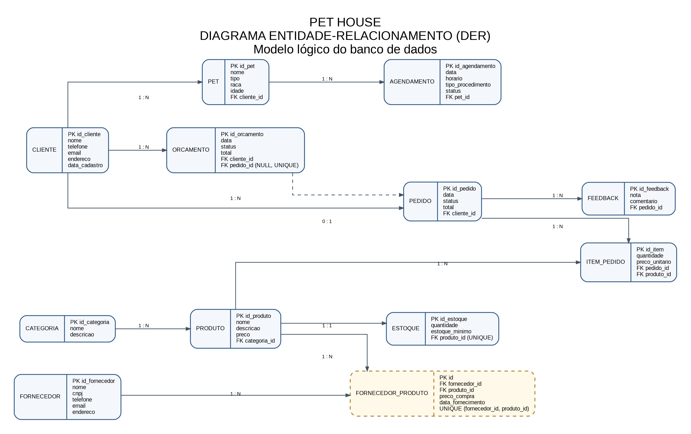

<div align="center">

# PetHouse

**Projeto de banco de dados para gestão de pet shop**

Modelagem de Dados · Grupo 7 · MySQL · 17 tabelas

[Documentação](documentacao/Documentacao_DER_PetHouse.docx) · [Script SQL](banco_de_dados/pethouse_script_sql_phpMyadmin.sql) · [Modelo lógico](documentacao/Projeto_Logico_PetHouse.pdf) · [Entrega do grupo](documentacao/Grupo_07.pdf)

</div>

---

## Sobre o projeto

A PetHouse é um pet shop de pequeno porte que vende produtos e oferece serviços agendados, como banho e tosa. O projeto propõe um banco de dados para centralizar informações que antes eram controladas em cadernos e planilhas.

| Área | Informações organizadas |
| --- | --- |
| Atendimento | Clientes, pets, agendamentos e avaliações |
| Vendas | Produtos, categorias, pedidos e orçamentos |
| Abastecimento | Fornecedores, preços de compra e estoque |
| Gestão | Funcionários, serviços, contas e movimento de caixa |

## Comece por aqui

| Material | Acesso |
| --- | --- |
| Implementação atual em MySQL | [Abrir script SQL](banco_de_dados/pethouse_script_sql_phpMyadmin.sql) |
| Documentação do projeto | [Baixar documento Word](documentacao/Documentacao_DER_PetHouse.docx) |
| Material de entrega do Grupo 7 | [Abrir PDF](documentacao/Grupo_07.pdf) |
| Projeto lógico | [Abrir PDF](documentacao/Projeto_Logico_PetHouse.pdf) |
| Orientações do professor | [Abrir manual](orientacoes/MANUAL%20DA%20ENTREGA%20FINAL.pdf) |

## Diagrama Entidade-Relacionamento

[](documentacao/diagramas/DER_PetHouse.png)

[Ver imagem em tamanho original](documentacao/diagramas/DER_PetHouse.png) · [Abrir arquivo-fonte do diagrama](documentacao/diagramas/DER_PetHouse.dot)

## Organização dos arquivos

| Pasta | Conteúdo |
| --- | --- |
| [banco_de_dados/](banco_de_dados/) | Script MySQL usado na implementação atual |
| [banco_de_dados/legado/](banco_de_dados/legado/) | Script PostgreSQL e backup da versão anterior |
| [documentacao/](documentacao/) | Documentação Word e arquivos PDF do projeto |
| [documentacao/diagramas/](documentacao/diagramas/) | Imagem e arquivo-fonte do DER |
| [orientacoes/](orientacoes/) | Manual de entrega fornecido pelo professor |

## Como importar no phpMyAdmin

**Requisito:** servidor MySQL 8.0.16 ou superior, com acesso ao phpMyAdmin e permissão para criar o banco `pethouse`.

1. Baixe o [script MySQL](banco_de_dados/pethouse_script_sql_phpMyadmin.sql). Na página do arquivo, use a opção de download do arquivo bruto.
2. Abra o phpMyAdmin, normalmente em `http://localhost/phpmyadmin`.
3. Acesse **Importar** e selecione `pethouse_script_sql_phpMyadmin.sql`.
4. Clique em **Executar** e aguarde a conclusão.
5. Selecione o banco `pethouse` e confira as 17 tabelas.

O script cria o banco, as tabelas, os dados de teste, os índices e os relacionamentos. Também inclui consultas de exemplo.

> Faça a importação inicial em um ambiente de estudo sem tabelas preexistentes no banco `pethouse`. O script usa `CREATE TABLE` e insere dados; executá-lo novamente sobre a mesma estrutura pode gerar erros de tabelas ou registros duplicados.

### Conferência após a importação

Na aba **SQL** do phpMyAdmin, execute:

```sql
USE pethouse;
SHOW TABLES;

SELECT COUNT(*) AS total_tabelas
FROM information_schema.tables
WHERE table_schema = 'pethouse'
  AND table_type = 'BASE TABLE';
```

O total esperado para a estrutura deste projeto é **17 tabelas**.

## Tabelas do banco

| Tabela | Para que serve |
|---|---|
| `cliente` | Cadastro dos clientes do pet shop |
| `pet` | Cadastro dos animais de cada cliente |
| `agendamento` | Reservas de banho, tosa e consultas |
| `produto` | Produtos vendidos pela loja |
| `categoria` | Categorias dos produtos (ração, higiene, brinquedos...) |
| `estoque` | Quantidade atual e mínima de cada produto |
| `fornecedor` | Empresas que abastecem a loja |
| `fornecedor_produto` | Qual fornecedor vende qual produto e por qual preço |
| `pedido` | Vendas realizadas |
| `item_pedido` | Produtos de cada pedido (quantidade e preço cobrado) |
| `orcamento` | Propostas feitas antes da venda |
| `feedback` | Avaliações dos clientes sobre os pedidos |
| `funcionario` | Cadastro dos funcionários |
| `servico` | Serviços oferecidos e seus preços |
| `conta_pagar` | Despesas e pagamentos |
| `conta_receber` | Valores a receber dos pedidos |
| `movimento_caixa` | Entradas, saídas e conciliação |

## Documentação do projeto

A [documentação em Word](documentacao/Documentacao_DER_PetHouse.docx) reúne a análise do pet shop, os requisitos, as regras de negócio, a modelagem, a normalização e o dicionário de dados.

O [projeto lógico](documentacao/Projeto_Logico_PetHouse.pdf) e o [material do Grupo 7](documentacao/Grupo_07.pdf) estão disponíveis na mesma pasta para consulta.

### Versões anteriores

A implementação atual utiliza **MySQL/phpMyAdmin**. Os arquivos PostgreSQL e o backup `.dump` foram preservados em [banco_de_dados/legado/](banco_de_dados/legado/) como referência histórica.

Esses arquivos não devem ser importados no phpMyAdmin. Para a implementação atual, utilize o script MySQL indicado acima.

## Integrantes do Grupo 7

1. Breno de Alencar Oliveira
2. Estefany Isidro Pachacuti
3. Giovanni Ferreira dos Santos
4. Jhoselia Abigail Pilco Mollo
5. Joana Manoele Freitas da Silva
6. Julia Vilela
7. Klener Nilmar Quispe Cari
8. Luan de Oliveira
9. Raphael David Silva Freitas
10. Ruan Silva Costa

<details>
<summary><strong>Contribuições dos integrantes</strong></summary>

**1. Breno de Alencar Oliveira:** Não participou das atividades de desenvolvimento do projeto.

**2. Estefany Isidro Pachacuti:** Ajudou na identificação das entidades e atributos e na organização das tabelas.

**3. Giovanni Ferreira dos Santos:** Ajudou na modelagem das tabelas associativas e colaborou com o grupo.

**4. Jhoselia Abigail Pilco Mollo:** Colaborou nas discussões, na análise das necessidades do sistema e na organização das atividades.

**5. Joana Manoele Freitas da Silva:** Ajudou na estruturação inicial do projeto e na identificação das entidades e tabelas.

**6. Julia Vilela:** Colaborou na análise dos requisitos e na organização das informações do sistema.

**7. Klener Nilmar Quispe Cari:** Ajudou nas discussões sobre a estrutura do banco de dados e na organização das informações.

**8. Luan de Oliveira:** Atuou como líder do grupo, auxiliando os integrantes na compreensão de entidades, atributos e tabelas.

**9. Raphael David Silva Freitas:** Colaborou na revisão das informações e na organização dos dados do projeto.

**10. Ruan Silva Costa:** Participou da identificação das entidades e atributos e da organização das informações do projeto.

</details>

---

Projeto acadêmico desenvolvido para a disciplina de **Modelagem de Dados**.
